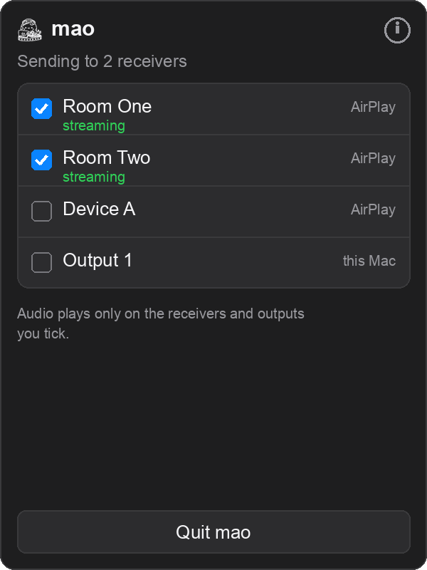

# mao

Version: 0.7.4

mao (Multi Audio/AirPlay Output) is a menu bar app for macOS. It sends your Mac's audio to several AirPlay receivers, such as HomePods, at once, and to one output on the Mac itself.

## Features

- **Several AirPlay receivers at once.** Tick any number of HomePods or other AirPlay receivers, and they play the same audio.
- **Receivers by their real names.** Discovery uses each receiver's own name, and leaves out this Mac.
- **One output on this Mac.** Tick the built-in speakers, headphones or another output, and macOS plays through it directly.
- **Silent unless ticked.** Audio plays only where you send it. With nothing ticked, the Mac is muted.
- **Start together.** Receivers begin playing once they have all connected, or after 10 seconds at most.
- **Add and remove without interruption.** Ticking or unticking a receiver doesn't restart the others.
- **Volume and mute for every streaming output.** Each AirPlay receiver, and each output on this Mac, has a volume slider and a mute button. Muting keeps the level for when you unmute.
- **Reconnects by itself.** A ticked receiver that drops off the network is retried every 10 seconds.
- **Remembers your outputs.** The outputs on this Mac you choose are saved. AirPlay receivers are not, so tick them once they have been found.
- **Follows the Mac's output at launch.** The output the Mac is using is ticked when mao starts.
- **Shows when it is searching.** A spinner appears while receivers are being looked for.
- **Finds devices as they change.** Receivers and outputs appear and disappear as you plug in or switch them off, without restarting mao. An output on this Mac that is no longer present is removed from the selection.
- **Menu bar app.** It has no Dock icon, and it can open at login from the info view.
- **Info view.** It shows the version, the help text, and the attributions.
- **Self-contained.** The streamer is bundled, so the app needs no Python installed.

## Quick start

<p align="center">
  
  <br>
  <em>The disk image. Drag mao into Applications.</em>
</p>

Requirements: macOS 14.2 or later (for the system-audio tap), Xcode command line tools (for `swiftc`), [Rust](https://rustup.rs), Node.js with npm, and Homebrew Python 3.12.

```sh
./mao                # set up what is missing, build the app and open it
./mao --dev          # run the development build
./mao --stop         # quit the running app
./mao --version      # print the version
```

The lower-level steps are `npm install`, `scripts/setup-python.sh` (the Python environment used to build the streamer), `npm run dev`, `npm run build`, and `npm test` (the Rust and Python tests).

The first time mao captures audio, macOS asks for permission to capture system audio. Allow it, or nothing is sent.

## Contents

- [Features](#features)
- [Using mao](#using-mao)
- [How it works](#how-it-works)
- [Limitations](#limitations)
- [Open at login](#open-at-login)
- [Project layout](#project-layout)
- [Help Support Development](#help-support-development)
- [Changelog](CHANGELOG.md)

## Using mao

<p align="center">
  
  <br>
  <em>The popover. The device names are placeholders.</em>
</p>

Click the mao icon in the menu bar. The popover lists the AirPlay receivers on your network and the outputs on this Mac (marked *this Mac*). Tick a receiver to send audio to it, and untick it to stop. AirPlay receivers are not remembered between launches: tick them once they have been found. Outputs on this Mac are remembered.

- **AirPlay receivers** can be ticked in any number, together with one output on this Mac.
- **One output on this Mac** can be ticked at a time. Ticking another one unticks the first.
- Devices appear and disappear as you plug them in or unplug them. AirPlay receivers are searched for each time the popover opens.
- Each ticked receiver shows its state: connecting, streaming, ended or error. Hover over an error for the reason.
- A streaming AirPlay receiver has a volume slider under its name, with a mute button at its left. Muting sets that receiver's own volume to zero, and unmuting restores the level it had. It does not change the Mac's volume.
- An output on this Mac has the same volume slider and mute button. They change that output's own volume. While that output is the Mac's system output, this is the Mac's volume.
- At launch, the output on this Mac that the Mac is currently using is ticked, so the popover matches what the Mac plays through.
- Quit mao with the button at the bottom of the popover.

## How it works

- `tap/mao-tap.swift` is a Core Audio helper. It copies the audio your Mac plays, and it sets the Mac's system output when an output on this Mac is ticked.
- When an AirPlay receiver is ticked, or nothing is ticked, the capture mutes the Mac's own output. Nothing plays on this Mac unless you tick an output on it.
- When an output on this Mac is ticked, it becomes the Mac's system output and macOS plays through it directly. mao restores the previous output when that output is unticked, and when mao quits.
- `python/mao_stream.py` finds AirPlay receivers with `pyatv` and streams the copied audio to each one. It sends silence when nothing is playing, so receivers stay connected between sounds. It is frozen into the app as `mao-stream`.
- The Rust app in `src-tauri/` runs the helpers, keeps the saved selection, and shows the popover.

## Limitations

- **One output on this Mac at a time.** The Mac has one system output, so mao can't play on two outputs on this Mac at once. AirPlay receivers can be combined with it.
- **Receivers drift apart.** They start together, but each has its own playback buffer. A measurement found Kitchen about 0.15 seconds behind Front Bedroom. mao doesn't correct this yet.
- **A dropped receiver is retried every 10 seconds** while it is ticked. If it stays away, it shows an error until it returns or you untick it.
- **AirPlay receivers are not remembered between launches.** Tick them once they have been found.
- **Volume and mute need a streaming receiver.** An AirPlay receiver's slider appears only while it is streaming. An output on this Mac needs a device that has a volume or mute control, and otherwise has no slider.
- **An output on this Mac is the Mac's volume.** While it is the system output, its slider changes the Mac's volume.
- **Ticking or unticking an output on this Mac restarts the capture.** This can cause a short gap in AirPlay audio.
- **The Mac's output is muted unless an output on this Mac is ticked.** Quit mao to get normal playback back.
- **The original output may not be restored.** mao restores the output it changed, but it can't tell what the output was if it was already the device you first ticked.
- **The streamer starts a little slower** than a plain Python script, because PyInstaller unpacks it on each start.
- **AirPlay depends on `pyatv`.** It speaks a protocol Apple doesn't publish, so an Apple update could break it. `pyatv` and `srptools` are pinned in `python/requirements.txt`.
- **macOS only.**

## Open at login

The info view has an *Open mao at login* switch. It writes a LaunchAgent to `~/Library/LaunchAgents/au.com.lateralblast.mao.plist`, which opens the installed app quietly at login. The switch needs the installed app, so it is disabled when running from a build directory.

## Project layout

- `src/`: the popover interface (HTML, CSS and JavaScript, with no build step).
- `src-tauri/src/lib.rs`: the menu bar icon, the popover window and the Tauri commands.
- `src-tauri/src/controller.rs`: the saved selection, the states of receivers and outputs, and routing.
- `src-tauri/src/stream.rs`: runs the tap and the streamer, and sets the system output.
- `src-tauri/src/devices.rs`: listens for device changes.
- `src-tauri/src/paths.rs`: finds the helpers, both in a built app and in the repo.
- `tap/mao-tap.swift`: the audio capture and output helper.
- `python/mao_stream.py`: AirPlay discovery and streaming, with tests in `python/test_mao_stream.py`.
- `scripts/`: build and setup scripts.

## Help Support Development

If you find this software useful and would like to support its development, please consider buying me a coffee:

https://ko-fi.com/richardatlateralblast

## Attribution

Hamster icons created by [MEDZ - Flaticon](https://www.flaticon.com/free-icons/hamster)

## Licence

Copyright 2026 Richard Spindler. Licensed under the Apache License, Version 2.0. See [LICENSE.md](LICENSE.md).
